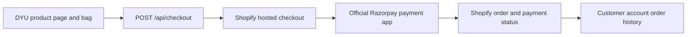

# Razorpay setup and launch handover

Prepared on October 4, 2026. This document prepares the existing Next.js storefront for a later merchant-led payment activation. This audit did not install or activate Razorpay, change the Shopify plan, submit payments, or issue refunds. Razorpay payment verification remains outstanding.

## Decision and current blocker

Use Shopify's official **All-in-one Razorpay Payment Gateway** integration, previously named **1 Razorpay / Razorpay Secure**. Connect the Razorpay account through the app's **OAuth login**. The current Shopify integration does **not require API keys**. The merchant must use the Razorpay account owner's credentials. [Razorpay Shopify prerequisites](https://razorpay.com/docs/payments/payment-gateway/ecommerce-plugins/shopify/), [Shopify integration FAQ](https://razorpay.com/docs/payments/payment-gateway/ecommerce-plugins/shopify/faqs)

The connected `dyuhandmade.myshopify.com` store was confirmed through Shopify's shop information as **Pause and Build**, with India/INR settings. Shopify disables checkout across sales channels on this plan. A working cart or login therefore does not prove that checkout can complete. The owner must first choose an eligible selling plan: **Settings → Plan → Pick a plan → Choose plan → review charges → Subscribe**. This is a billing decision to make when ready; the project has not changed it. [Shopify: pausing and reopening a store](https://help.shopify.com/en/manual/your-account/manage-orgs-and-stores/manage-pricing-plan/pause-store)

No independent Razorpay checkout should bypass this restriction. Keep one commerce and order flow:

The code already hands off the current Shopify cart to its `checkoutUrl`. `src/app/api/checkout/route.ts` refreshes the buyer identity before returning the URL; `StoreProvider` navigates there from the bag. Shopify documents this URL as the cart's hosted checkout. Our architectural inference is that a payment provider enabled for that checkout is usable from this headless storefront too; the acceptance checks below must confirm it for this merchant, domain, and payment method. [Shopify Storefront cart and checkout](https://shopify.dev/docs/storefronts/headless/building-with-the-storefront-api/cart/manage)

## Why no Razorpay SDK or new payment API in Next.js

The supported payment app integrates with Shopify's checkout lifecycle. Shopify restricts building new payment extensions to eligible approved partners and certain eligible Plus custom integrations; this project is a storefront, not a payment provider. [Shopify payment apps platform](https://shopify.dev/docs/apps/build/payments)

A separate Razorpay checkout would create a separate payment flow. A Razorpay success callback alone would not complete the Shopify cart, associate its customer, or safely produce the expected Shopify order. An independently built bridge would need authoritative prices, taxes, shipping and discounts; inventory reservation; server-side payment verification; retry-safe order creation; customer association; refunds; and reconciliation. Running both flows or retrying without idempotency can create duplicate orders or stock changes, or a captured payment with no Shopify order. These are architectural failure scenarios, not observed production incidents.

Retaining Shopify checkout avoids introducing that second order system. Do not add Razorpay credentials to `.env`, `NEXT_PUBLIC_*`, browser storage, source control, or chat for this integration. No Razorpay package or payment endpoint is required in this repository. If a separate custom payment project is requested later, scope and review it independently.

## Merchant setup when ready

1. Finish Razorpay account activation/KYC and website review. Confirm the intended legal merchant, settlement account, India eligibility, and accepted currencies. Keep credentials within official Shopify/Razorpay screens. [Razorpay prerequisites](https://razorpay.com/docs/payments/payment-gateway/ecommerce-plugins/shopify/)
2. Have the owner activate an eligible Shopify selling plan as described above. Record existing payment providers and modes before making payment-setting changes.
3. In **Settings → Payments → Additional payment methods → Add payment method**, search by provider for **All-in-one Razorpay Payment Gateway**. Older screens may show **1Razorpay - UPI, Cards, Wallets, NB**. Follow the official installation link and app flow; choose the existing-user option, log in as the Razorpay account owner, connect, then activate in Shopify. [Razorpay integration steps](https://razorpay.com/docs/payments/payment-gateway/ecommerce-plugins/shopify/integration-steps)
4. Verify that the connected merchant is correct. Shopify supports one Razorpay merchant ID per store in this integration. Avoid leaving both the legacy and replacement Razorpay options visible. The separate **Razorpay Direct** option is cards-only; use All-in-one for the intended combination of cards, UPI, wallets, and netbanking. [Razorpay FAQ](https://razorpay.com/docs/payments/payment-gateway/ecommerce-plugins/shopify/faqs)
5. Coordinate a protected test window. In the app's Shopify payment settings, enable **Test mode** and save before any payment test. Test mode must be clearly visible. Use the provider's published test credentials, never a real payment instrument. Gateway test mode affects real shoppers, so do not switch a trading storefront without an agreed window. [Shopify payment test mode](https://help.shopify.com/en/manual/checkout-settings/test-orders/payments-test-mode)
6. Complete the test matrix, reconcile results, and record evidence. Leave live activation for the merchant's launch decision. Do not confuse the provider's generic SDK API-key instructions with this OAuth-based Shopify app.

## Test protocol and acceptance evidence

Begin only after checkout is enabled and the official gateway is demonstrably in test mode. Use approved test customer details and a controlled product/quantity. Record stock before testing. Prevent fulfillment and external fulfillment automation for these orders; do not send a shipment or buy a label.

Start each test from the actual DYU storefront: add a variant, review the bag, continue to Shopify checkout, verify delivery and totals, choose Razorpay, then use its test payment screen. Razorpay documents `success@razorpay` and `failure@razorpay` for test UPI and simulated success/failure for test netbanking/wallets. Its current integration page also lists test cards. UPI Intent and QR need separate live-mode verification and are not proven by these test results. [Razorpay test instructions](https://razorpay.com/docs/payments/payment-gateway/ecommerce-plugins/shopify/integration-steps)

The following is the proposed acceptance plan, not a record of completed Razorpay tests:

| Scenario | Expected result and evidence |
| --- | --- |
| Guest success, desktop and mobile | Correct variant, quantity, final amount/currency, delivery, and one paid Shopify order; matching captured Razorpay test payment. |
| Signed-in success | Correct customer at checkout; the same order appears in that customer's DYU account and order details after refresh. Another account cannot access it. |
| Failure or declined test payment | Clear retry path; no paid status or fulfillment. Check any pending/abandoned records before retrying. |
| Cancel, close, or browser back | Return/recovery is understandable; inspect both dashboards before paying again; no duplicate paid order. |
| Slow response, interrupted return, or reload | Reconcile the original attempt before retry. Payment state is determined from Shopify/provider records, not the presence of a success page. |
| Rapid repeated checkout clicks | No duplicate submission from the bag; inspect order/payment counts after the attempt. |
| Inventory boundary and unavailable variant | Checkout rejects unavailable quantities; one successful order changes inventory once according to Shopify settings. |
| Discounts, shipping, tax, and currency | Shopify checkout's final total is the charged amount, including applicable discounts and shipping/tax. Test intended delivery regions. |
| Partial refund, full refund, cancellation | Correct Shopify and Razorpay states; accurate remaining refundable amount; intended inventory/restock effect; no duplicate refund. |
| Sign-out and account switch | Previous customer's account data is cleared; checkout/order history uses the current customer. |

For each case, keep a private test record with date, mode, storefront origin, scenario, Shopify order reference, Razorpay payment/order reference, amount/currency, expected and actual status, and cleanup outcome. Do not place customer data, session cookies, tokens, OTPs, or complete checkout URLs in public logs/screenshots.

Reconcile using the Shopify payment reference and the corresponding Razorpay transaction/order reference; Razorpay also documents a Shopify Payments Report for bulk reconciliation. [Razorpay reconciliation](https://razorpay.com/docs/payments/payment-gateway/ecommerce-plugins/shopify/reconcile-payments)

The existing mocked browser tests in `tests/account-checkout.spec.ts` cover the storefront handoff, server-error handling, navigation, and pending-button behavior. They cannot prove provider settlement, inventory effects, refunds, or customer order creation. A Shopify Bogus Gateway test can test Shopify order handling but is not evidence that Razorpay works.

## Refunds, cancellations, and webhook ownership

Use **Shopify Admin → Orders → the order → Refund** as the operational refund entry point for this integration. Check the amount actually paid after discounts, select the intended partial/full refund, and verify both systems afterward. Do not independently refund the same payment again in the Razorpay dashboard. [Razorpay Shopify refunds](https://razorpay.com/docs/payments/payment-gateway/ecommerce-plugins/shopify/initiate-refunds)

Cancellation, refund, and restocking are separate decisions. Inspect the transaction before canceling; choose the correct refund and restock options, especially if it was already refunded. Clean up only identified test orders, retain the audit trail, and avoid bulk actions on real orders. [Shopify cancellation guidance](https://help.shopify.com/en/manual/fulfillment/managing-orders/canceling-orders)

The official payment app owns its Shopify payment integration and provider callbacks. This storefront should display Shopify's authoritative order/payment status and should not independently capture, mark paid, create replacement orders, or decrement stock. Razorpay documents automatic capture for this integration; verify a captured payment before fulfillment. [Razorpay FAQ](https://razorpay.com/docs/payments/payment-gateway/ecommerce-plugins/shopify/faqs)

The existing `/api/revalidate` endpoint only invalidates Shopify catalog caches. It is not a payment webhook. No new Razorpay webhook is required in DYU for the recommended native app setup. Future business notifications should be designed around verified Shopify events and must not duplicate the provider's payment processing.

If a separately scoped feature later genuinely requires a direct Razorpay webhook, validate `X-Razorpay-Signature` against the raw body with HMAC-SHA256, use durable duplicate detection via `x-razorpay-event-id`, and tolerate out-of-order delivery. Test the endpoint before any financial state changes; webhook secrets belong in deployment secret storage. [Razorpay webhook validation](https://razorpay.com/docs/webhooks/validate-test/)

## Permanent-domain launch and rollback

The temporary Cloudflare preview is for verification, not permanent hosting. Before launching:

- Deploy to the final HTTPS storefront origin and set `NEXT_PUBLIC_SITE_URL` before building. Set `CUSTOMER_ACCOUNT_SITE_URL` to that origin or remove the temporary override as appropriate.
- Register the exact final Customer Account callback, logout, and JavaScript origin in Shopify; see [customer-account-setup.md](customer-account-setup.md). Keep required active URLs until the transition is verified, then remove obsolete preview callbacks.
- Configure `SHOPIFY_CHECKOUT_DOMAIN` only for a verified custom Shopify checkout hostname. Set `SHOPIFY_BUYER_IP_HEADER` only for a header overwritten by the production hosting proxy. Do not carry the temporary Cloudflare header assumption onto another host.
- Repeat guest and authenticated checkout, account history, sign-out, and mobile checks from the final origin. Check return links, store navigation, privacy/refund/shipping information, fulfillment settings, and gateway eligibility for that domain.
- With merchant launch authorization, disable **Test mode** and save. Verify that the intended live Razorpay option appears once. The Shopify-specific Razorpay FAQ explicitly says to uncheck test mode for live processing; do not follow contradictory generic wording suggesting test mode should remain enabled. [Razorpay FAQ](https://razorpay.com/docs/payments/payment-gateway/ecommerce-plugins/shopify/faqs)
- Any real-money smoke payment, refund, or UPI Intent/QR test requires a separately authorized amount and payment instrument. Do not infer authorization from test-mode approval.

If a test fails, stop further payment attempts and compare Shopify and Razorpay records first. Keep the new gateway inactive or restore the exact recorded pre-test configuration as appropriate; do not deactivate the store's working payment provider blindly. Escalate mismatched payment/order states to provider support with redacted references. Never delete records, mark an order paid manually, or retry a refund just to make the test appear successful. Re-run the failed acceptance case after the cause is understood.

## Dependency audit snapshot

Read-only checks on October 4, 2026:

| Check | Result |
| --- | --- |
| `npm audit --json` | 0 known vulnerabilities: critical 0, high 0, moderate 0, low 0, informational 0. |
| `npm audit signatures` | 118 packages had verified registry signatures; 38 had verified attestations. |
| Lockfile provenance | Lockfile v3; all recorded resolved package tarballs used `https://registry.npmjs.org/`; no registry package was missing an integrity value. |
| Changes made by audit | No packages installed, upgraded, or added; no manifest or lockfile changes. |

This is a point-in-time dependency finding. It does not establish that every package has an attestation, review all package source code, or replace the application/security and checkout acceptance checks.
